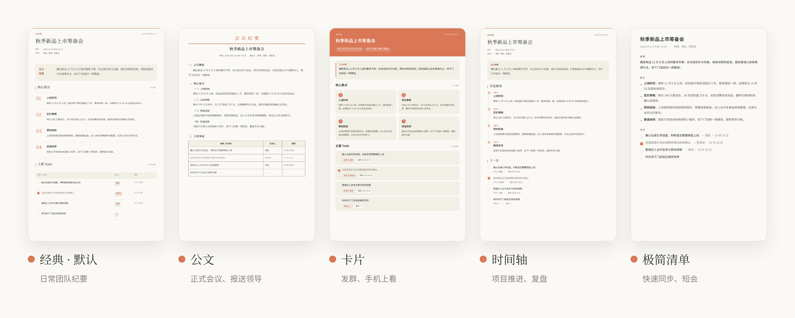
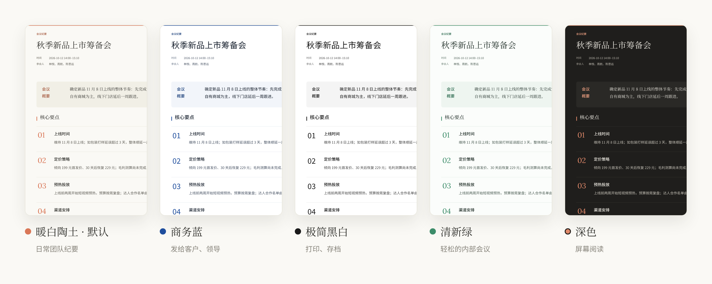

<picture>
  <source media="(prefers-color-scheme: dark)" srcset="docs/banner-dark.png">
  
</picture>

<p align="center">
  <a href="https://github.com/sunxuwang001-sketch/meeting_offline/releases/latest"></a>
  <a href="LICENSE"></a>
  
</p>

<p align="center">
  <a href="#让-ai-帮你安装">让 AI 安装</a>　·　<a href="#纪要样式">纪要样式</a>　·　<a href="#和-obsidian-一起用">Obsidian</a>　·　<a href="#深度洞察可选">深度洞察</a>　·　<a href="#转写云端还是本地">转写方案</a>　·　<a href="#怎么用">怎么用</a>　·　<a href="#常见问题">常见问题</a>
</p>

<br>

**meeting_offline** 是一个装进 AI 助手里的会议纪要技能。

把会议录音交给它，告诉它谁是谁，就能得到一份简洁的纪要：主题、时间、参会人、核心要点和主要 Todo。纪要同时交付可直接修改的网页（HTML）、一张可以发到群里的图片（PNG），以及 Markdown 版的纪要和逐字稿。

> 现在是 **1.0 测试版**：功能还在快速迭代，遇到问题或有想法，欢迎在 [Issues](https://github.com/sunxuwang001-sketch/meeting_offline/issues) 里告诉我。

<p align="center"></p>

<br>

## 让 AI 帮你安装

在 Codex、Claude Code、WorkBuddy 等 AI 工具里说：

> 帮我安装这个技能：https://github.com/sunxuwang001-sketch/meeting_offline

AI 会按 [INSTALL.md](INSTALL.md) 选择合适的方式装好，重新打开工具即可使用。

<br>

## 它能做什么

<picture>
  <source media="(prefers-color-scheme: dark)" srcset="docs/workflow-dark.png">
  
</picture>

- **不编造**：负责人和期限只写会上说过的，没说就留空；发布前把金额、日期、否定和“已决定”逐条和原话对照，对不上的改正或由你确认
- **你来确认**：谁是谁、专有名词怎么写，都在本机打开的复核页面里由你拍板，拿不准可以直接回听原声
- **越用越快**：确认过的人名和术语会记住，下次自动给出候选
- **好看能改**：5 种版式 × 5 种配色随时切换，网页点一下就能改，改完一键导出图片
- **没有 Key 也能用**：可以在自己电脑上本地识别，录音不上传
- **手机录完自动转写（Mac）**：录音存进 iCloud 云盘的“会议录音”文件夹，电脑在后台转写好后提醒你回来确认
- **Obsidian 友好**：会议文件夹直接归档进库，用库里的人名和项目名纠正识别错误
- **深度洞察（可选）**：每个人的诉求、背后考虑和前后变化，单独一份只给你看

短会议（不超过 2 位发言人）更省事：认领和纪要草稿一起给你，回复一次就定稿。

<br>


<p align="center"><sub>切换版式和配色　·　点击文字直接修改　·　保存 HTML 留住修改　·　导出图片生成 PNG　·　<a href="docs/example.png">查看完整纪要图片</a></sub></p>

<br>

## 纪要样式

<picture>
  <source media="(prefers-color-scheme: dark)" srcset="docs/layouts-dark.png">
  
</picture>

**版式**决定排版：经典、公文（红头、“一、（一）”编号、全框表格）、卡片、时间轴、极简清单。

<picture>
  <source media="(prefers-color-scheme: dark)" srcset="docs/styles-dark.png">
  
</picture>

**配色**决定颜色和标题字体：暖白陶土、商务蓝、极简黑白、清新绿、深色。

两者可以任意组合。在网页工具栏的“版式”“样式”菜单里随时切换，导出的图片跟着变；也可以直接对 AI 说“用公文版式出一版”“卡片配商务蓝”，或者“以后都用极简清单”。

<br>

## 和 Obsidian 一起用

对 AI 说“以后把会议纪要放进我的 Obsidian 库”，之后每场会议都归档进库里的 `会议纪要` 文件夹：

```
会议纪要/
└── 2026-10-12_秋季新品上市筹备会/
    ├── 会议纪要.md     日期、参会人等属性，要点，Todo 复选框，嵌入图片和录音
    ├── 逐字稿.md       按说话人分段、带时间戳
    ├── 会议纪要.png
    ├── 会议纪要.html
    └── 新录音 3.m4a
```

- 参会人在库里有笔记的，自动写成 `[[双链]]`，人物笔记里就能看到这个人参加过的会议
- 转写里读音相同、写法不同的词（比如把“贝联”识别成“背联”），按库里的写法列成一份清单，你回一句“都对”就全部改好
- 库里的人名和笔记标题可以作为热词，让识别偏向这些写法；本地识别时热词不出电脑
- 你在 Obsidian 里改过的笔记不会被覆盖

不用 Obsidian 也会得到这两份 Markdown，放在默认的会议文件夹里。

<br>

## 深度洞察（可选）

说“帮我做一份深度洞察”，会另外得到一份只给你看的 `深度洞察.md`，逐个分析参会人：

- **本场诉求**：每个人在会上明确要什么
- **背后考虑**：可能的利益、约束和顾虑
- **场内变化**：会上立场怎么变的，因为什么
- **跨会议变化**：和这个人之前的会比有什么不同（只用这台电脑上、你确认过是同一个人的会议）

每一条都附原话和时间戳，标明是“事实”还是“推断”以及把握程度：

> **背后考虑**
> - 可能担心降价后难以恢复原价、影响渠道。（推断 · 把握中等）
>   `00:03:12` 林悦：我还是想守住 229 元，渠道那边压力太大。

它不进纪要正文和图片，只分析工作上的立场，不评价性格和私事。想每场都做，说一句“以后每场都做深度洞察”。

<br>

## 手动安装

**Claude Code**：在 Claude Code 里输入

```
/plugin install meeting-offline --marketplace sunxuwang001-sketch/meeting_offline
```

这条命令需要 Claude Code v2.1.275 或更新版本。版本较旧时分两步：

```
/plugin marketplace add sunxuwang001-sketch/meeting_offline
/plugin install meeting-offline@meeting-offline
```

**Codex、Cursor 等支持 `npx skills` 的工具**

```bash
npx skills add sunxuwang001-sketch/meeting_offline --skill meeting-offline -g
```

**WorkBuddy、CodeBuddy，或一次装到所有工具**：下载 [`local.zip`](https://github.com/sunxuwang001-sketch/meeting_offline/releases/latest)，解压后在文件夹里运行

```bash
python3 install.py        # Windows：py -3 install.py
```

**ChatGPT、Claude.ai**：下载 [`upload.zip`](https://github.com/sunxuwang001-sketch/meeting_offline/releases/latest)，在技能设置里上传。

装好后重新打开 AI 工具。第一次转写录音时，AI 会问你用云端还是本地，见下一节。

<br>

## 转写：云端还是本地

纪要需要先把录音转成“区分说话人”的文字，三种方式任选：

| | 阿里云（云端） | FunASR（本地） | Whisper（本地） |
| :-- | :-- | :-- | :-- |
| 需要 API Key | 需要 | 不需要 | 不需要 |
| 录音会上传吗 | 上传到阿里云 | 不上传 | 不上传 |
| 中文准确度 | 高 | 高 | 中等 |
| 要另外安装 | 不用 | 约 0.5～3 GB | 约 0.2～0.5 GB |
| 适合 | 想省事 | 普通话会议 | 中英混说 |

有阿里云 Key 最省事；没有也没关系，AI 会说明差别，你选好后它来装。申请 Key 的步骤和各方案的详细对比见 [转写方案指南](skills/meeting-offline/references/transcription-options.md)。

<br>

## 怎么用

直接用平常的话告诉它：

| 你想做的 | 对 AI 说 |
| :-- | :-- |
| 整理录音 | 整理这份会议录音：~/Downloads/周会.m4a |
| 找最近的录音 | 帮我找一下最近的会议录音 |
| 用语音备忘录 | 用语音备忘录里最新那条录音出纪要 |
| 手机录的会 | 手机录的会怎么给你？ |
| 手机录完自动转写 | 帮我开启录音收件箱 |
| 不想上传录音 | 用本地识别整理这段录音 |
| 改人名 | 1-B 其实是王五，重新出一版 |
| 改错词 | “普罗”应该是“示例Pro” |
| 换样式 | 用公文版式出一版 / 换成卡片配商务蓝 |
| 重新出图 | 我改了这份 HTML，帮我重新生成图片 |
| 放进 Obsidian | 以后把纪要放进我的 Obsidian 库 |
| 深度洞察 | 帮我做一份深度洞察 |

<br>

## 隐私

| 内容 | 在哪里 |
| :-- | :-- |
| 录音 | 留在你电脑上；只有选择阿里云转写并同意后才上传 |
| 转写文字 | 交给你所用的 AI 工具阅读，和平时聊天一样 |
| 人名和术语库 | 只存在本机 `~/.meeting-offline/` |
| 纪要文件 | 在本机生成，不依赖在线服务 |
| Obsidian 库 | 只在本机读取笔记标题、别名和标签，不上传、不改动已有笔记；用阿里云转写时要把库里的词当热词，会先问你 |
| 深度洞察 | 单独的文件，不进纪要和图片，也不进人名术语库 |
| 录音收件箱 | 只用本地识别，不上传；通知里只有文件名，没有会议内容 |

想清空积累的数据，删除 `~/.meeting-offline/` 文件夹即可；开过录音收件箱的，先对 AI 说“关掉录音收件箱”。

<br>

## 常见问题

<details>
<summary>要付费吗？</summary>
<br>

技能免费（MIT 许可证）。你需要自己的 AI 工具账号。用阿里云转写时按量计费，新用户通常有一定免费额度（以百炼控制台为准）；用本地识别完全免费。
</details>

<details>
<summary>没有 API Key 能用吗？</summary>
<br>

能。选本地识别（FunASR 或 Whisper），录音不离开你的电脑，只是第一次要安装依赖、下载模型。想申请阿里云 Key 的话，步骤见 [转写方案指南](skills/meeting-offline/references/transcription-options.md#云端阿里云百炼-api-key)；拿到 Key 后不要贴到对话里，按指南存在本机。
</details>

<details>
<summary>它会不会把人认错？</summary>
<br>

它不会自己认人。AI 会在本机打开一个复核页面，每位说话人都附上观点、原话和回听按钮，由你填上是谁；以前确认过的人会作为候选预先选好，仍需你确认后保存。认错了随时说“1-B 其实是……”。录音里没能分开说话人的部分会如实告诉你并单独标出，不会算到任何人头上。
</details>

<details>
<summary>负责人和期限是怎么来的？</summary>
<br>

只有会上明确认领或被指派的事项才写负责人，期限也只写有人说过的。会议日期不确定时，“下周一”这类说法保留原样，不会换算成具体日期。
</details>

<details>
<summary>支持哪些录音？</summary>
<br>

m4a、wav、mp4，手机和电脑自带的录音机、语音备忘录、会议软件的云录制都是这几种。没告诉它文件在哪时，它会在 iCloud 云盘、下载、桌面里找最近的录音给你选。用 iPhone 录的会，存进 iCloud 云盘的“会议录音”文件夹就能被找到，做法见 [用手机录会议](skills/meeting-offline/references/iphone-recording.md)，也可以做成一键快捷指令。在 Mac 上还可以开启 [录音收件箱](skills/meeting-offline/references/inbox.md)：录音同步过来后在后台用本地识别转写好，弹通知提醒你回来确认，录音不上传。只有文字稿、没有录音的情况暂不支持。
</details>

<details>
<summary>深度洞察会被别人看到吗？</summary>
<br>

它是单独的 `深度洞察.md`，不出现在纪要网页、图片和 `会议纪要.md` 里，也不写进人名术语库。它和录音放在同一个会议文件夹，转发整个文件夹前记得删掉它。
</details>

<details>
<summary>需要什么环境？Windows 能用吗？</summary>
<br>

需要 Python 3.9 或更新版本。生成图片用本机的 Chrome、Edge 或 Chromium，没有也没关系，在网页里点“导出图片”即可。Windows 和 Linux 可以安装使用，读取 Apple 语音备忘录只支持 macOS（[配置说明](skills/meeting-offline/references/voice-memos-setup.md)）。目前主要在 macOS 上实际使用过。
</details>

<details>
<summary>录音能有多长？</summary>
<br>

阿里云转写最长 12 小时、1 GB；5 分钟以内的录音随请求直接发送，更长的存入阿里云临时存储，最长保留 48 小时。超过 2 小时且要区分说话人时，会先征求你的确认。本地识别没有时长限制，只是越长越慢。
</details>

<details>
<summary>换了电脑怎么办？</summary>
<br>

新电脑从空库开始积累，不同电脑的数据不会混在一起。同一台电脑上的不同 AI 工具共用一份数据。
</details>

<details>
<summary>从旧版 meeting-minutes 升级会丢数据吗？</summary>
<br>

不会。运行新版 `install.py`，旧技能会移到 `skill-backups/`，原有的人名、术语和转写缓存继续可用。
</details>

<details>
<summary>给开发者</summary>
<br>

```
skills/meeting-offline/   技能本体（各工具安装的就是这个文件夹）
  SKILL.md                主流程、纪要要求和硬性规则
  references/             各环节详细说明
  scripts/                找录音、转写（云端/本地）、录音收件箱、工作区、内容核对、HTML/PNG/Markdown、归档、Obsidian、深度洞察、本地库
  assets/                 纪要模板（5 种版式 × 5 种配色）、复核页面、拼音表
  tests/                  单元测试
INSTALL.md                写给 AI 助手的安装说明
install.py                本机安装器
build_package.py          更新校验值并打包
.claude-plugin/           Claude Code 插件清单
.github/workflows/        自动发布 Release
```

测试：`cd skills/meeting-offline && python3 -m unittest discover -s tests`（只用标准库；本地识别引擎用替身测试，不需要安装）

打包：`python3 build_package.py --out dist`。改动 `skills/meeting-offline/` 后都要运行它更新 `MANIFEST.json`，否则安装器会拒绝安装。

发布：在 `CHANGELOG.md` 加一节 `## 版本号`（正式版之前是 `1.0.0-beta.N`），运行 `python3 build_package.py --version 版本号`，提交并合并到 `main`，GitHub Actions 会自动测试、打包并发布 Release。
</details>

<br>

<p align="center"><sub>MIT 许可证 © 2026 sunxuwang001-sketch　·　示例中的会议、人名和数据均为虚构</sub></p>
