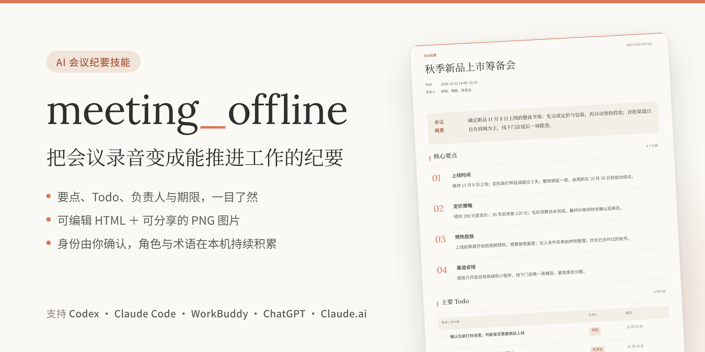
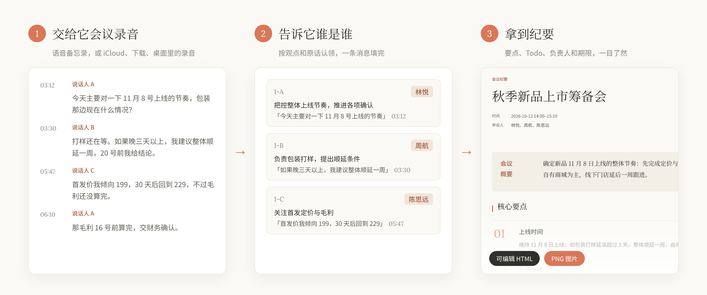
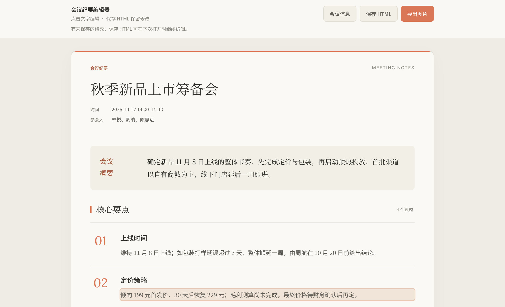

<picture>
  <source media="(prefers-color-scheme: dark)" srcset="docs/banner-dark.png">
  
</picture>

<p align="center">
  <a href="https://github.com/sunxuwang001-sketch/meeting_offline/releases/latest"></a>
  <a href="LICENSE"></a>
  
</p>

<p align="center">
  <a href="#让-ai-帮你安装">让 AI 安装</a>　·　<a href="#手动安装">手动安装</a>　·　<a href="#怎么用">怎么用</a>　·　<a href="#常见问题">常见问题</a>
</p>

<br>

**meeting_offline** 是一个装进 AI 助手里的会议纪要技能。

把会议录音或转写交给它，告诉它谁是谁，就能得到一份简洁的纪要：主题、时间、参会人、核心要点和主要 Todo。纪要同时交付可直接修改的网页（HTML）和一张可以发到群里的图片（PNG）。

<br>

## 让 AI 帮你安装

在 Codex、Claude Code、WorkBuddy 等 AI 工具里说：

> 帮我安装这个技能：https://github.com/sunxuwang001-sketch/meeting_offline

AI 会按 [INSTALL.md](INSTALL.md) 选择合适的方式装好，重新打开工具即可使用。

<br>

## 它能做什么

<picture>
  <source media="(prefers-color-scheme: dark)" srcset="docs/workflow-dark.png">
  
</picture>

- **不编造**：负责人和期限只写会上说过的，没说就留空
- **你来确认**：谁是谁、专有名词怎么写，都由你拍板
- **越用越快**：确认过的人名和术语会记住，下次自动给出候选
- **直接能用**：网页点一下就能改，改完一键导出图片

短会议（不超过 2 位发言人）更省事：认领和纪要草稿一起给你，回复一次就定稿。

<br>



<p align="center"><sub>点击文字直接修改　·　保存 HTML 留住修改　·　导出图片生成 PNG　·　<a href="docs/example.png">查看完整纪要图片</a></sub></p>

<br>

## 手动安装

**Claude Code**：在 Claude Code 里输入

```
/plugin install meeting-offline --marketplace sunxuwang001-sketch/meeting_offline
```

**Codex、Cursor 等支持 `npx skills` 的工具**

```bash
npx skills add sunxuwang001-sketch/meeting_offline --skill meeting-offline -g
```

**WorkBuddy、CodeBuddy，或一次装到所有工具**：下载 [`local.zip`](https://github.com/sunxuwang001-sketch/meeting_offline/releases/latest)，解压后在文件夹里运行

```bash
python3 install.py        # Windows：py -3 install.py
```

**ChatGPT、Claude.ai**：下载 [`upload.zip`](https://github.com/sunxuwang001-sketch/meeting_offline/releases/latest)，在技能设置里上传。

装好后重新打开 AI 工具。需要把录音转成文字时，还要配置一次阿里云 DashScope API Key，见[常见问题](#常见问题)；已有文字稿可以跳过。

<br>

## 怎么用

直接用平常的话告诉它：

| 你想做的 | 对 AI 说 |
| :-- | :-- |
| 整理录音 | 整理这份会议录音：~/Downloads/周会.m4a |
| 用语音备忘录 | 用语音备忘录里最新那条录音出纪要 |
| 已有文字稿 | 把这份会议文字稿整理成纪要 |
| 改人名 | 1-B 其实是王五，重新出一版 |
| 改错词 | “普罗”应该是“示例Pro” |
| 重新出图 | 我改了这份 HTML，帮我重新生成图片 |

<br>

## 隐私

| 内容 | 在哪里 |
| :-- | :-- |
| 录音 | 留在你电脑上；你同意转写时才上传到阿里云 |
| 转写文字 | 交给你所用的 AI 工具阅读，和平时聊天一样 |
| 人名和术语库 | 只存在本机 `~/.meeting-offline/` |
| 纪要文件 | 在本机生成，不依赖在线服务 |

想清空积累的数据，删除 `~/.meeting-offline/` 文件夹即可。

<br>

## 常见问题

<details>
<summary>要付费吗？</summary>
<br>

技能免费（MIT 许可证）。你需要自己的 AI 工具账号；转写录音时，阿里云 DashScope 按量计费，已有文字稿则不需要。
</details>

<details>
<summary>怎么配置转写用的 API Key？</summary>
<br>

在阿里云百炼控制台创建 DashScope API Key。macOS 运行已安装技能里的 `scripts/setup_keychain.sh`，密钥会存进钥匙串；其他系统设置环境变量 `DASHSCOPE_API_KEY`。不要把密钥贴到对话里。
</details>

<details>
<summary>它会不会把人认错？</summary>
<br>

它不会自己认人。每位说话人都会附上观点和原话，由你说出是谁；以前确认过的人会作为候选出现，仍需你确认。认错了随时说“1-B 其实是……”。
</details>

<details>
<summary>负责人和期限是怎么来的？</summary>
<br>

只有会上明确认领或被指派的事项才写负责人，期限也只写有人说过的。会议日期不确定时，“下周一”这类说法保留原样，不会换算成具体日期。
</details>

<details>
<summary>需要什么环境？Windows 能用吗？</summary>
<br>

需要 Python 3.9 或更新版本，只用标准库。生成图片用本机的 Chrome、Edge 或 Chromium；没有也没关系，在网页里点“导出图片”即可。Windows 和 Linux 可以安装使用，读取 Apple 语音备忘录只支持 macOS（[配置说明](skills/meeting-offline/references/voice-memos-setup.md)）。目前主要在 macOS 上实际使用过。
</details>

<details>
<summary>录音能有多长？上传到阿里云的录音怎么处理？</summary>
<br>

最长 12 小时、1 GB。5 分钟以内的录音随请求直接发送；更长的存入 DashScope 临时存储，最长保留 48 小时。超过 2 小时且要区分说话人时，会先征求你的确认。
</details>

<details>
<summary>换了电脑怎么办？</summary>
<br>

新电脑从空库开始积累，不同电脑的数据不会混在一起。同一台电脑上的不同 AI 工具共用一份数据。
</details>

<details>
<summary>从旧版 meeting-minutes 升级会丢数据吗？</summary>
<br>

不会。运行新版 `install.py`，旧技能会移到 `skill-backups/`，原有的人名、术语和转写缓存继续可用。
</details>

<details>
<summary>给开发者</summary>
<br>

```
skills/meeting-offline/   技能本体（各工具安装的就是这个文件夹）
  SKILL.md                主流程、纪要要求和硬性规则
  references/             各环节详细说明
  scripts/                转写、工作区、HTML/PNG、归档、本地库
  tests/                  单元测试
INSTALL.md                写给 AI 助手的安装说明
install.py                本机安装器
build_package.py          更新校验值并打包
.claude-plugin/           Claude Code 插件清单
.github/workflows/        自动发布 Release
```

测试：`cd skills/meeting-offline && python3 -m unittest discover -s tests`

打包：`python3 build_package.py --out dist`。改动 `skills/meeting-offline/` 后都要运行它更新 `MANIFEST.json`，否则安装器会拒绝安装。

发布：在 `CHANGELOG.md` 加一节 `## X.Y.Z`，运行 `python3 build_package.py --version X.Y.Z`，提交并合并到 `main`，GitHub Actions 会自动测试、打包并发布 Release。
</details>

<br>

<p align="center"><sub>MIT 许可证 © 2026 sunxuwang001-sketch　·　示例中的会议、人名和数据均为虚构</sub></p>
