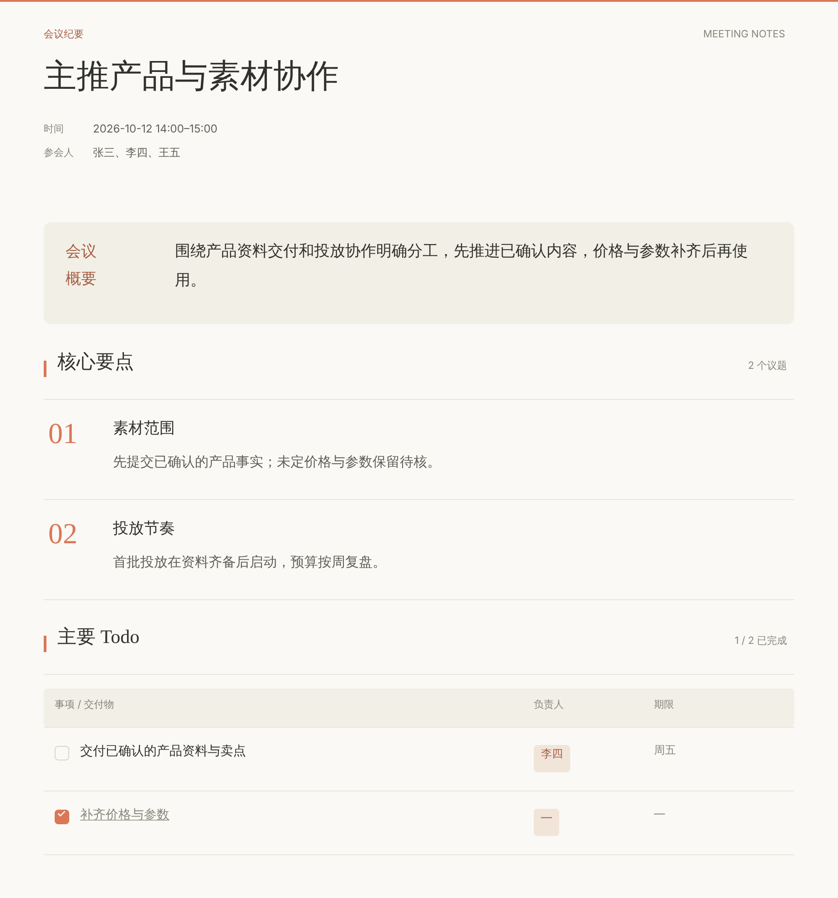

# meeting_offline · 会议纪要技能

把会议录音或转写整理成一份简洁的会议纪要：**主题、时间、参会人、核心要点、主要 Todo**。交付可直接编辑的 HTML 和一张 PNG 图片。说话人身份和关键术语由你确认，确认过的角色与术语会在本机持续积累，下次开会自动给出候选。

这是一个 AI 助手技能（SKILL.md 格式），可在 Codex、Claude Code、WorkBuddy、CodeBuddy、ChatGPT 和 Claude.ai 中使用。

<p align="center"></p>

<p align="center"><sub>示例图，内容为虚构</sub></p>

## 它做什么

1. **录音归档**：把选定的录音移动到 `会议纪要/日期_主题/` 文件夹，纪要做好后放在同一处。
2. **转写**（只有音频时）：内置阿里云 Qwen 转写脚本；也支持直接导入已有转写和 Apple 语音备忘录（只读）。
3. **说话人认领**：每位说话人给一张卡片，列出核心观点和带时间戳的原话，由你填写他是谁。身份只由你确认，不靠猜测。
4. **术语复核**：对影响理解的人名、产品名，给出原文和候选写法让你选；只改你勾选的段落，不会机械地全局替换。
5. **写纪要**：综合整场讨论，分清决定、方向和建议；负责人和期限只写有依据的内容，不虚构。
6. **交付**：生成可编辑 HTML，并用本机浏览器在后台直接导出 PNG。之后你在 HTML 里改完，可以在页面里点“导出图片”，也可以让助手重新出图。
7. **积累**：你确认过的角色和术语存进本机库，下次自动预填候选。

短会议（不超过 2 位发言人）会把认领和纪要草稿合并成一条消息，你回复一次就能定稿。

## 安装

到 [Releases](https://github.com/sunxuwang001-sketch/meeting_offline/releases/latest) 下载安装包：

| 安装包 | 用在哪里 |
| --- | --- |
| `meeting_offline-<版本>-local.zip` | Codex、Claude Code、WorkBuddy、CodeBuddy（装在电脑上的工具） |
| `meeting_offline-<版本>-upload.zip` | 直接上传到 ChatGPT、Claude.ai，或在 WorkBuddy 里导入 |

### 本机工具：Codex / Claude Code / WorkBuddy / CodeBuddy

解压 `local.zip`，在解压出的目录里运行：

```bash
python3 install.py          # Windows: py -3 install.py
```

也可以直接 `git clone https://github.com/sunxuwang001-sketch/meeting_offline.git`，在仓库目录里运行同样的命令。

安装器会自动检测本机装了哪些工具，并全部装好；只装其中一个时加 `--target`：

| 工具 | 命令 | 安装位置 | 调用 |
| --- | --- | --- | --- |
| Codex | `--target codex` | `~/.agents/skills/` | `$meeting-offline` |
| Claude Code | `--target claude` | `~/.claude/skills/` | `/meeting-offline` |
| WorkBuddy | `--target workbuddy` | `~/.workbuddy/skills/` | 新开会话直接描述任务 |
| CodeBuddy / WorkBuddy 企业版 | `--target codebuddy` | `~/.codebuddy/skills/` | 新开会话直接描述任务 |

其他工具用 `--skills-dir <该工具的 skills 目录>`。在任何工具里也都可以直接说“整理这份会议录音”。

### 云端：ChatGPT / Claude.ai

在工具里上传 `meeting_offline-<版本>-upload.zip`（从 Releases 下载，或在仓库里运行 `python3 build_package.py --out dist` 自己打包）：

- ChatGPT：在技能设置里上传（需要支持技能的工作区套餐，个人版目前可能没有这个功能）。
- Claude.ai：设置 → 功能 → 技能 → 上传。
- WorkBuddy 也可以在应用内导入同一个上传包。

云端运行在临时沙箱里，接触不到你的电脑：需要上传录音或转写稿，结束时把 `memory.json` 一起下载，下次上传后可以继续积累。

## 环境要求

- Python 3.9+，只用标准库，不需要安装额外的 Python 包。
- Chrome、Edge 或 Chromium 之一，用于直接生成 PNG；没有时 HTML 照常可用，在页面里点“导出图片”即可。
- 需要转写时：阿里云 DashScope API Key 和 curl。macOS 可运行 `meeting-offline/scripts/setup_keychain.sh` 把密钥存进钥匙串，其他平台设置环境变量 `DASHSCOPE_API_KEY`。
- 读取 Apple 语音备忘录（可选，仅 macOS）：见 [voice-memos-setup.md](meeting-offline/references/voice-memos-setup.md)。

已在 macOS 上实际使用；Windows/Linux 有离线测试，尚未做实机端到端验证。

## 数据与隐私

- **只在本机**：角色库、术语库、会议工作区和转写缓存存放在 `~/.meeting-offline/devices/<设备ID>/`，归档在 `~/Documents/会议纪要/<设备ID>/`。同一台电脑上的各个 AI 工具共用这一份数据。
- **按设备隔离**：不同电脑各自从空库开始，即使同步了用户目录也不会混用。设备 ID 只保存系统标识的哈希摘要。
- **云端上传需授权**：只有你同意转写某段录音时，才会把它上传到阿里云；角色和术语的修改不会重新上传。整理纪要和生成 PNG 都在本机完成。
- **仓库不含任何个人数据**：没有会议内容、录音、人物档案或密钥。

## 仓库结构

```
meeting-offline/          技能本体
  SKILL.md                主流程、纪要要求和硬性规则
  references/             各环节详细说明（转写、认领、术语、交付、安装等）
  scripts/                Python 脚本（转写、工作区、HTML/PNG 生成、归档、本地库）
  assets/                 HTML 模板
  tests/                  单元测试
install.py                本机安装器
build_package.py          更新 MANIFEST 校验值并打包
CHANGELOG.md              更新记录（也用作 Release 说明）
.github/workflows/        推送版本标签后自动发布 Release
MANIFEST.json             技能文件校验值，安装器据此校验
安装说明.txt              随安装包分发的简要说明
```

## 开发

```bash
cd meeting-offline
python3 -m unittest discover -s tests       # 运行测试（本机有 Chromium 时会包含 PNG 渲染测试）
cd ..
python3 build_package.py --version X.Y.Z --out dist   # 改完技能文件后更新校验值并打包
```

`MANIFEST.json` 记录技能文件的校验值；改动 `meeting-offline/` 下的任何文件后，都要运行 `build_package.py` 更新它，否则安装器会拒绝安装。

发布新版本：在 `CHANGELOG.md` 加上 `## X.Y.Z` 一节，用 `build_package.py --version X.Y.Z` 更新版本号并提交，合并到 `main`。GitHub Actions 发现这个版本还没有 Release，就会运行测试、打包，创建 `vX.Y.Z` 标签和附带两个安装包的 Release（推送 `vX.Y.Z` 标签或在 Actions 页面手动运行也可以）。

从 11.5 之前的版本（技能名 `meeting-minutes`）升级时，直接运行新的 `install.py` 即可：旧技能会移到 `skill-backups/`，原有的角色和术语继续可用。

## 许可证

[MIT](LICENSE)
