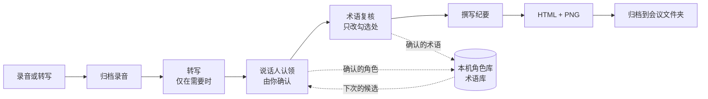

<p align="center">
  
</p>

<p align="center">
  <a href="https://github.com/sunxuwang001-sketch/meeting_offline/releases/latest"></a>
  <a href="LICENSE"></a>
  
  
</p>

<p align="center">
  <a href="#快速开始"><b>快速开始</b></a> ·
  <a href="https://github.com/sunxuwang001-sketch/meeting_offline/releases/latest"><b>下载</b></a> ·
  <a href="#你可以这样说">怎么用</a> ·
  <a href="#隐私与数据">隐私</a> ·
  <a href="#常见问题">常见问题</a>
</p>

---

开完会最费时间的往往不是开会本身，而是之后的整理：谁说了什么、最后定了什么、哪件事由谁在什么时候之前完成。

**meeting_offline** 是一个装进 AI 助手里的技能。把录音或转写交给它，告诉它谁是谁，就能拿到一份简洁的会议纪要：**主题、时间、参会人、核心要点、主要 Todo**，同时给你一份可直接修改的网页和一张可以发到群里的图片。

## 为什么用它

- **结论清楚，不编造**：区分“已决定”“方向”和“建议”；负责人和期限只写会上真正说过的，不确定就留“—”。
- **人和词由你确认**：每位说话人都配上观点和原话，你认一下就行；人名、产品名有疑问时给你候选，只改你勾选的地方。
- **越用越省事**：确认过的角色和术语保存在你电脑上，下次开会自动给出候选，不用每次重新填。
- **拿来就能用**：HTML 点击文字就能改，改完一键导出图片；图片按内容自动排版，适合直接分享。
- **在你常用的 AI 工具里用**：Codex、Claude Code、WorkBuddy、CodeBuddy、ChatGPT、Claude.ai 都可以。

## 三步上手

<p align="center"></p>

短会议（不超过 2 位发言人）更快：认领卡片和纪要草稿会在同一条消息里给你，回复一次就能定稿。

## 效果一览

<table>
  <tr>
    <th width="42%">纪要图片（PNG）</th>
    <th>可编辑网页（HTML）</th>
  </tr>
  <tr>
    <td valign="top"></td>
    <td valign="top">
      
      <br><br>
      <ul>
        <li>点击任意文字直接修改，可增删要点和 Todo、勾选完成</li>
        <li>“会议信息”里补填时间和参会人</li>
        <li>“保存 HTML”保留修改，“导出图片”生成新的 PNG</li>
        <li>完全离线，不加载任何外部资源</li>
      </ul>
    </td>
  </tr>
</table>

<p align="center"><sub>示例中的会议、人名和数据均为虚构</sub></p>

## 快速开始

### 1. 下载

到 [Releases](https://github.com/sunxuwang001-sketch/meeting_offline/releases/latest) 下载对应的安装包：

| 你用的工具 | 下载 |
| --- | --- |
| Codex、Claude Code、WorkBuddy、CodeBuddy（装在电脑上的） | `meeting_offline-<版本>-local.zip` |
| ChatGPT、Claude.ai（网页 / App） | `meeting_offline-<版本>-upload.zip` |

### 2. 安装

**电脑上的工具**：解压 `local.zip`，在解压出的文件夹里运行

```bash
python3 install.py        # Windows：py -3 install.py
```

安装器会找到你电脑上装了哪些 AI 工具，并全部装好。只想装某一个时加 `--target codex`、`claude`、`workbuddy` 或 `codebuddy`。

> 💡 **不想碰命令行？** 直接把 `local.zip` 发给你的 Codex、Claude Code 或 WorkBuddy，对它说：“请解压这个压缩包，运行里面的 install.py 安装技能。”

**ChatGPT / Claude.ai**：在技能设置里上传 `upload.zip`。

- ChatGPT：需要支持技能的工作区套餐（Business、Enterprise、Edu）。
- Claude.ai：设置 → 功能 → 技能 → 上传。
- WorkBuddy 也可以在应用内“专家 → 技能 → 添加技能 → 导入技能”导入这个包。

### 3. 开始用

重新打开 AI 工具，直接说“整理这份会议录音”就行。也可以点名调用：Codex 输入 `$meeting-offline`，Claude Code 输入 `/meeting-offline`。

需要把录音转成文字时，还要配置一次阿里云 DashScope（百炼）的 API Key，在阿里云百炼控制台创建即可：macOS 运行已安装技能里的 `scripts/setup_keychain.sh`，把密钥存进钥匙串；其他系统设置环境变量 `DASHSCOPE_API_KEY`。已经有文字稿的话可以跳过这一步。

## 你可以这样说

| 场景 | 对 AI 说 |
| --- | --- |
| 整理一段录音 | 整理这份会议录音：`~/Downloads/周会.m4a` |
| 用语音备忘录 | 用语音备忘录里最新那条录音出纪要 |
| 已有文字稿 | 这是会议软件导出的文字稿，帮我整理成纪要 |
| 认错了人 | 1-B 其实是王五，重新出一版 |
| 词识别错了 | “普罗”应该是“示例Pro”，只改第二段 |
| 自己改过 HTML | 我改了这份 HTML，帮我重新生成图片 |
| 继续上次的会 | 继续整理昨天那场周会 |

## 工作原理



- 录音会移动到 `~/Documents/会议纪要/<设备ID>/日期_主题/`，做好的 HTML 和 PNG 放在同一个文件夹里。
- 纪要由你的 AI 助手阅读转写后撰写；脚本只负责转写、校验、排版和归档，不会自己编写总结。
- 修改角色或术语只会重新生成文件，不会重新上传录音。

## 隐私与数据

| 内容 | 去哪里 |
| --- | --- |
| 录音文件 | 留在你电脑上；只有你同意转写时，才会上传到阿里云 DashScope |
| 转写文字 | 由你使用的 AI 工具阅读，会发送给该工具的模型服务，和你平时在其中聊天一样 |
| 角色库、术语库、会议工作区 | 只存在本机 `~/.meeting-offline/`，不随技能分发，也不会上传 |
| HTML 和 PNG | 在本机生成，不依赖任何在线服务 |
| API Key | 存在系统钥匙串或环境变量里，不写进任何文件 |

- 不同电脑各自从空库开始，即使同步了用户目录也不会混用。
- 上传给阿里云的录音按其规则处理：5 分钟以内随请求直接发送；更长的录音存入 DashScope 临时存储，最长保留 48 小时。
- 想清空积累的数据，删除 `~/.meeting-offline/` 文件夹即可。

## 常见问题

<details>
<summary><b>要付费吗？</b></summary>

技能本身免费，采用 MIT 许可证。你需要自己的 AI 工具账号；用到录音转写时，阿里云 DashScope 按量计费。已有文字稿就不需要转写。
</details>

<details>
<summary><b>没有 API Key 能用吗？</b></summary>

能。把会议软件导出的文字稿、语音备忘录自带的转写或任何带说话人的文字记录交给它即可。只有需要把录音转成文字时才用到 API Key。
</details>

<details>
<summary><b>它会不会把人认错？</b></summary>

它不会自己认人。每位说话人都会列出观点和原话，由你告诉它是谁。以前确认过的人会作为候选出现，但仍要你确认。认错了随时说“1-B 其实是……”，纪要会重新生成。
</details>

<details>
<summary><b>负责人和期限是怎么来的？</b></summary>

只有会上有人明确认领或被指派的事项才写负责人，期限也只写有人说过的。提出建议的人不会被自动当成负责人。会议日期不确定时，“下周一”这样的说法会保留原样，不会换算成具体日期。
</details>

<details>
<summary><b>Windows 和 Linux 能用吗？</b></summary>

能安装和使用。读取 Apple 语音备忘录只支持 macOS，其他系统直接提供录音文件即可。目前主要在 macOS 上实际使用过；Windows 和 Linux 已通过自动化测试，还没有完整的实机验证，遇到问题欢迎提 Issue。
</details>

<details>
<summary><b>没有 Chrome 怎么生成图片？</b></summary>

生成 PNG 需要本机有 Chrome、Edge 或 Chromium 中的任意一个。没有的话，HTML 照常交付，在网页里点“导出图片”就能得到同样的 PNG。
</details>

<details>
<summary><b>换了电脑怎么办？</b></summary>

新电脑会从空库开始积累，这是有意的设计，避免不同电脑的数据混在一起。同一台电脑上的不同 AI 工具共用一份数据。
</details>

<details>
<summary><b>录音能有多长？</b></summary>

转写支持最长 12 小时、1 GB 以内的录音。超过 2 小时且需要区分说话人时，会先提醒你转写服务的建议，再由你确认是否继续。
</details>

<details>
<summary><b>从旧版 meeting-minutes 升级会丢数据吗？</b></summary>

不会。直接运行新版 `install.py`，旧技能会移到 `skill-backups/`，原有的角色、术语和转写缓存继续可用。
</details>

## 环境要求

- Python 3.9 或更新版本，只用标准库，不需要另外安装 Python 包
- Chrome、Edge 或 Chromium 之一，用于直接生成 PNG（可选）
- 需要转写时：阿里云 DashScope API Key 和 curl
- 读取 Apple 语音备忘录（可选，仅 macOS）：见 [配置说明](meeting-offline/references/voice-memos-setup.md)

<details>
<summary><b>给开发者</b></summary>

### 仓库结构

```
meeting-offline/          技能本体
  SKILL.md                主流程、纪要要求和硬性规则
  references/             各环节详细说明（转写、认领、术语、交付、安装等）
  scripts/                Python 脚本（转写、工作区、HTML/PNG 生成、归档、本地库）
  assets/                 HTML 模板
  tests/                  单元测试
install.py                本机安装器
build_package.py          更新 MANIFEST 校验值并打包
MANIFEST.json             技能文件校验值，安装器据此校验
CHANGELOG.md              更新记录（也用作 Release 说明）
.github/workflows/        版本号更新合并到 main 后自动发布 Release
docs/                     README 配图
```

### 测试与打包

```bash
cd meeting-offline
python3 -m unittest discover -s tests      # 本机有 Chromium 时会包含 PNG 渲染测试
cd ..
python3 build_package.py --out dist        # 生成 local.zip 和 upload.zip
```

`MANIFEST.json` 记录技能文件的校验值。改动 `meeting-offline/` 下的任何文件后，都要运行 `build_package.py` 更新它，否则安装器会拒绝安装。

### 发布新版本

1. 在 `CHANGELOG.md` 顶部加上 `## X.Y.Z` 一节；
2. 运行 `python3 build_package.py --version X.Y.Z` 并提交；
3. 合并到 `main`。

GitHub Actions 发现这个版本还没有 Release，就会运行测试、打包，创建 `vX.Y.Z` 标签和附带两个安装包的 Release。

</details>

## 许可证

[MIT](LICENSE) © 2026 sunxuwang001-sketch
